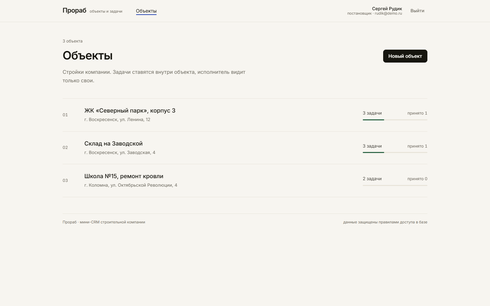
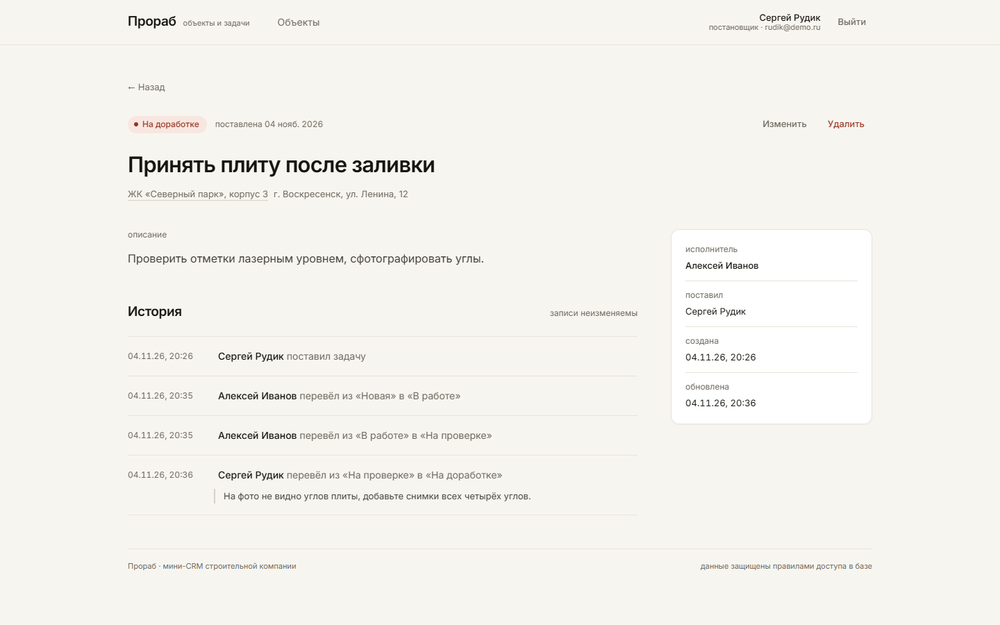

# Прораб: мини-CRM «Объекты и задачи»

Небольшая CRM для строительной компании. Постановщик заводит объекты и задачи, назначает исполнителей, принимает работу или возвращает на доработку. Исполнитель видит только свои задачи, берёт их в работу и отправляет на проверку. Каждая смена статуса попадает в неизменяемую историю.

Демо: https://mini-crm-eight-sigma.vercel.app




Стек: React 19 + TypeScript + Vite, Tailwind CSS 4, Supabase (Postgres + Auth + PostgREST). Вся логика доступа живёт в базе: RLS-политики и триггеры. В браузер уходит только publishable-ключ, секретный ключ в клиенте и в репозитории не используется.

[](https://github.com/Rimigon/mini-crm/actions/workflows/ci.yml)

## Демо-доступы

| Роль | Почта | Пароль |
| --- | --- | --- |
| Постановщик | rudik@demo.ru | Demo1234 |
| Исполнитель | ivanov@demo.ru | Demo1234 |
| Исполнитель | petrova@demo.ru | Demo1234 |

Регистрация отключена в настройках Supabase (проверяется запросом к `/auth/v1/signup`: ответ `signup_disabled`). Учётные записи и профили заводятся администратором вручную.

## Что защищено в базе

- RLS включён на всех таблицах, права на таблицы выданы только роли `authenticated`; `anon` не видит ничего.
- Исполнителю политиками разрешён только `select` собственных задач и тех объектов, где у него есть задачи. Права на запись в `tasks` у него нет вовсе.
- Смена статуса возможна только через функцию `change_task_status`, которая проверяет роль, исполнителя и саму пару «из статуса в статус». Триггер `tasks_before_update` дополнительно не даёт изменить `status` прямым `update`, даже если его отправит постановщик.
- Возврат на доработку без комментария не проходит: проверка есть и в функции, и в триггере.
- История пишется триггером `tasks_write_history` под владельцем таблицы. На `task_history` нет политик на запись, а триггер `task_history_immutable_trigger` запрещает `update` и `delete` даже владельцу таблицы через API. Пропускается только каскадное удаление вместе с задачей, и это действие доступно лишь постановщику.
- Автора задачи, дату создания и идентификатор изменить нельзя; исполнителем можно назначить только сотрудника с ролью «исполнитель», в том числе при переназначении.
- Длины полей ограничены и на клиенте, и в базе: название объекта до 120 символов, адрес до 200, название задачи до 140, описание и комментарий до 2000.

В Supabase дополнительно включено: регистрация закрыта, минимальная длина пароля 8 символов. Security Advisor показывает 0 ошибок; оставшиеся предупреждения относятся к функциям, которые обязаны быть доступны вошедшим пользователям для работы RLS, и к защите от утёкших паролей (доступна только на платном плане).

## Проверки

```bash
pnpm lint              # oxlint
pnpm typecheck         # tsc -b
pnpm test              # 15 unit-тестов правил интерфейса и разбора ошибок
pnpm build             # сборка
pnpm check:security    # 17 сценариев доступа на живой базе
```

`check:security` подключается к Postgres от имени роли `authenticated` с подставленными JWT-claims и проверяет, что видит исполнитель и какие запросы и переходы отбиваются. Нужен `.env.local` с доступом к базе. В GitHub Actions крутятся lint, типы, тесты и сборка: `.github/workflows/ci.yml`.

## Запуск локально

```bash
pnpm install
cp .env.example .env        # вписать адрес проекта и publishable-ключ
pnpm dev
```

Переменные окружения:

```
VITE_SUPABASE_URL=https://<project-ref>.supabase.co
VITE_SUPABASE_ANON_KEY=<publishable key>
```

## База

Миграции лежат в `supabase/migrations` и применяются по порядку:

1. `0001_schema.sql`: типы, таблицы, индексы.
2. `0002_security.sql`: RLS, права, триггеры, функция смены статуса.
3. `0003_history_cascade.sql`: история уходит только вместе со своей задачей, прямая правка и удаление по-прежнему запрещены.
4. `0004_hardening.sql`: ограничения длины, проверка исполнителя при переназначении, `search_path` и права на триггерные функции.
5. `0005_indexes.sql`: индексы под внешние ключи и стабильные вызовы `auth.uid()` в политиках.

Применить можно SQL Editor в Supabase (по файлу за раз) или скриптом через прямое подключение к Postgres:

```bash
node scripts/db.mjs migrate      # прогон всех миграций
node scripts/db.mjs sql файл.sql # любой разовый SQL
```

Скрипту нужен `.env.local` с `SUPABASE_PROJECT_REF` и `SUPABASE_DB_PASSWORD`, подключение идёт через session pooler.

Демо-данные (три сотрудника, три объекта, семь задач в разных статусах с настоящей историей переходов):

```bash
node scripts/seed.mjs
```

Скрипт использует secret-ключ только на своей машине и только для создания тестовых пользователей через Admin API.

## Структура

```
src/
  auth/AuthContext.tsx      сессия и профиль сотрудника
  lib/api.ts                запросы к Supabase и понятные ошибки
  lib/rules.ts              какие действия доступны роли и статусу
  lib/limits.ts             ограничения длины полей
  lib/errors.ts             перевод ошибок базы на человеческий язык
  lib/*.test.ts             unit-тесты
  pages/                    вход, объекты, объект, задача, мои задачи, 404
  components/               каркас, модальные окна, статусы, границы ошибок
supabase/migrations/        схема и правила безопасности
scripts/                    миграции, засев данных, проверка доступа
docs/                       объяснение для руководителя и список решений
```

## Деплой

Сборка статическая (`pnpm build`, папка `dist`). На Vercel заданы переменные окружения, rewrite всех путей на `index.html` и заголовки безопасности: CSP, `X-Frame-Options`, `X-Content-Type-Options`, `Referrer-Policy`, `Permissions-Policy`, HSTS.

## Что не сделано

Поиск и пагинация, realtime-обновления, вложения и уведомления, экран сводки по всем задачам для постановщика. Подробнее в [docs/решения-и-допущения.md](docs/решения-и-допущения.md).
